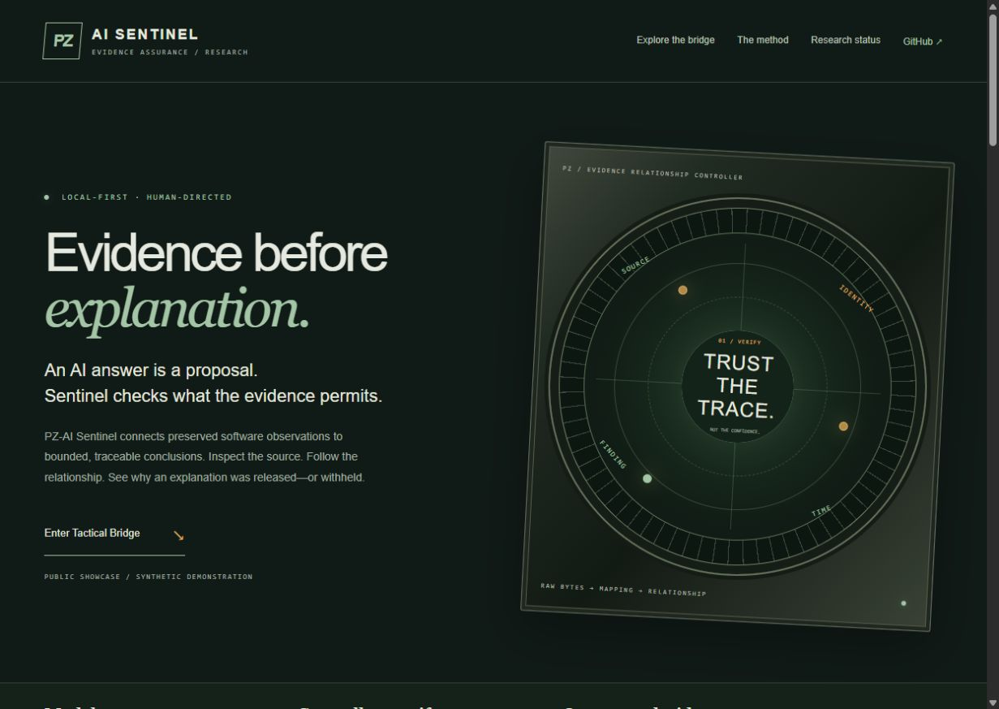
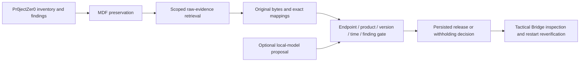

# PZ-AI Sentinel

### Evidence before explanation.

A public showcase of a local-first controller for evidence-based software assurance and its **Tactical Bridge** operator interface.

**[Explore the showcase](https://tbg-chance.github.io/PZ-AI-Sentinel-showcase/)** · [Capabilities & boundaries](docs/STATUS.md) · [Research status](docs/RESEARCH.md) · [Demo contract](docs/DEMONSTRATION.md)



Sentinel treats a model answer as a proposal. Explicit controller checks determine whether the evidence supports releasing an attributed finding explanation. Operators can inspect sources, relationships, missing evidence and retained session history.

This repository contains an original public presentation and a browser-only illustration using invented records. It does not distribute the application engine, private lab records, credentials, model weights or operational configuration.

## Explore the demonstration

The muted-green instrument console lets you switch between six evidence conditions: matched records, wrong product, neighboring version, stale observation, missing inventory and conflicting findings. Its export produces an explicitly synthetic JSON record.

The illustration performs no security assessment, runs no model and connects to no Sentinel, MDF or Pr0jectZer0 service. Its conclusions are authored examples of the intended boundary. See the [exact assumptions](docs/DEMONSTRATION.md).

## How the application works



- **Integrity:** retrieve bounded original bytes and verify recorded hashes and exact mapping history within authorized scope.
- **Relationship:** reconcile endpoint, product, version, observation time and the specific finding before release.
- **Traceability:** retain evidence references, decisions and audit checkpoints in saved sessions.
- **Operator control:** explicitly start configured analysis, follow progress, cancel and inspect completed sessions.

The workflow analyzes preserved records. It does not automatically collect fresh endpoint inventory or apply remediation. .NET remediation guidance remains attributed to Pr0jectZer0.

## What the research establishes—and does not

The current bounded profiles cover .NET runtime, Python Core Interpreter and Node.js. A separate 36-case synthetic development set was exercised in 216 retained local-model attempts across two configurations. A further 18 synthetic cases await independent blinded review and have no model answers yet. The original 48-case corpus remains unchanged.

**Independent accuracy validation is pending.** In the bounded-schema development run, the model proposed support for every attempt; the deterministic gate blocked all 90 negative opportunities under author-proposed labels. This demonstrates a boundary on those cases, not reliable model reasoning or general vulnerability detection. [Read the full results and limitations](docs/RESEARCH.md).

## Run this showcase locally

Requires Python 3, with no package installation or build step:

```powershell
python -m http.server 8080 --bind 127.0.0.1
```

Open `http://127.0.0.1:8080`. All styling, scripts and artwork are local. The site uses no analytics, cookies, external fonts or backend requests.

Run the public artifact checks with:

```powershell
node --test tests/showcase.test.cjs
```

## GitHub Pages

The included workflow publishes the static showcase from `main`. Repository administrators must select **GitHub Actions** under **Settings → Pages → Build and deployment → Source** if Pages has not already been enabled. The workflow runs artifact checks before deployment. The project can also be served by any static web host.

## Repository guide

| File | Purpose |
| --- | --- |
| `index.html`, `styles.css`, `app.js` | Public presentation and synthetic interactive bridge |
| `assets/` | Original public-safe graphics |
| `docs/STATUS.md` | Implemented capabilities, constraints and next milestones |
| `docs/RESEARCH.md` | Aggregate development results and evaluation limitations |
| `docs/DEMONSTRATION.md` | Invented data and simulation assumptions |
| `tests/showcase.test.cjs` | Scenario behavior, export, static-link and publication-boundary checks |

Public status reflects project documentation reviewed on **20 October 2026**. This showcase is not an installable Sentinel release or an independently audited security certification.
